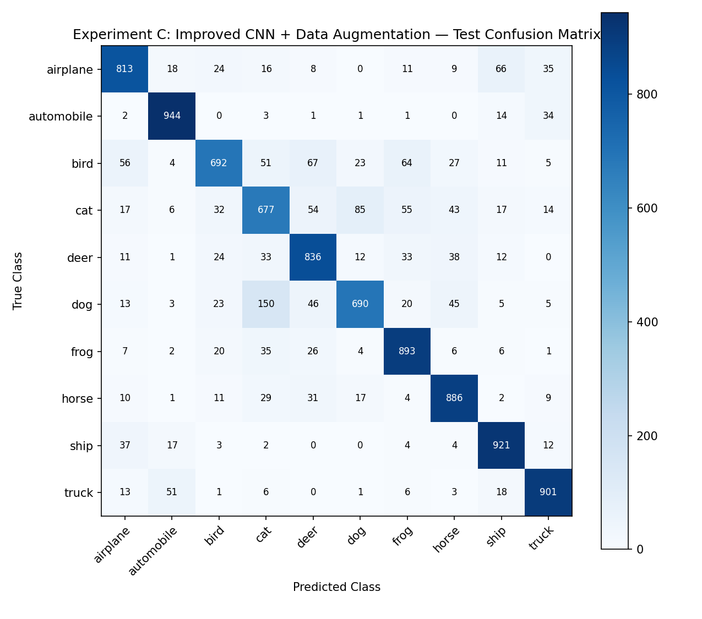

# Reproducible CNN Experiments on CIFAR-10

I trained three CNN configurations on [CIFAR-10](https://www.cs.toronto.edu/~kriz/cifar.html) to see how training-image augmentation and a redesigned model affect test accuracy across three random seeds. The aim is to demonstrate controlled model comparison, careful validation-based model selection, multi-seed evaluation, and error analysis—not to propose a new computer-vision method.

## Portfolio snapshot

Across nine 30-epoch CIFAR-10 runs using seeds 41, 42, and 43, checkpoints were selected by validation accuracy and then evaluated on the official held-out test set. Mean test accuracy was 75.04% for the baseline, 80.01% for the augmented baseline, and 82.58% for the redesigned model with augmentation. The baseline preview advanced its training sampler before epoch one, and the redesign changed several architectural choices together.

## Question

Starting from an interpretable two-block CNN, this project asks:

1. Does random crop plus horizontal flip improve the baseline's held-out performance?
2. Does a compact third convolutional block with batch normalization and dropout improve the augmented baseline?
3. Are those observations stable across more than one random seed?

## Data and protocol

- **Dataset:** CIFAR-10: 60,000 `32×32` RGB images in ten balanced classes.
- **Split:** for each run, the official 50,000-image training set is deterministically split into 45,000 training and 5,000 validation images using that run's seed. The official 10,000-image test set is kept separate.
- **Model selection:** the checkpoint with the highest validation accuracy is selected during training, then evaluated on the held-out test set.
- **Seeds:** 41, 42, and 43. Every condition runs at every seed for 30 epochs, giving 9 completed full training runs.
- **Optimizer:** SGD (learning rate 0.01, momentum 0.9, weight decay `5e-4`) with cross-entropy loss.
- **Hardware:** CPU. Reported runtimes are therefore machine-dependent and included only as an approximate efficiency comparison.

## Compared conditions

| ID | Architecture | Augmentation | Trainable parameters | Purpose |
| --- | --- | --- | ---: | --- |
| A | `BaselineCNN`: two convolutional blocks | None | 1,070,794 | Reference model |
| B | `BaselineCNN`: two convolutional blocks | Random padded crop + horizontal flip | 1,070,794 | Compares the augmented workflow with A |
| C | `ImprovedCNN`: three convolutional blocks, batch normalization, dropout 0.3 | Random padded crop + horizontal flip | 620,586 | Compares the complete deeper architecture with B |

Both models output raw logits directly to `nn.CrossEntropyLoss`; no redundant Softmax layer is applied before the loss.

For a given seed, A and B use the same data split. A’s training preview advances its sampler before epoch one, so the two runs begin with different batches.

## Main results

Values below are the mean ± sample standard deviation across the three completed seeds. The raw per-seed results and the exact aggregate calculation are versioned in [`outputs/repeated/`](outputs/repeated/).

| Experiment | Best validation accuracy | Test accuracy | Macro F1 | Mean training time |
| --- | ---: | ---: | ---: | ---: |
| A — baseline | 76.08% ± 0.33% | 75.04% ± 0.36% | 0.7499 ± 0.0032 | 29.8 min |
| B — baseline + augmentation | 80.64% ± 0.61% | 80.01% ± 0.72% | 0.7982 ± 0.0084 | 32.3 min |
| C — improved + augmentation | **83.33% ± 0.40%** | **82.58% ± 0.07%** | **0.8248 ± 0.0030** | 42.2 min |

In this setup, B exceeds A by 4.97 percentage points on average, and C exceeds B by 2.57 points. The redesigned model reached 82.58% mean test accuracy and used 42% fewer trainable parameters. Its mean CPU training time was 42.2 minutes, compared with 29.8 minutes for the baseline. Its very small three-seed test standard deviation (0.07 percentage points) is encouraging, but this remains a small educational experiment rather than a claim of general superiority.

## Representative diagnostics

The images below are the outputs from seed 42, labeled as a representative individual run rather than the aggregate result. All three seeds' numerical results appear in the versioned CSV files.



Confusion matrix for condition C, seed 42. Use the class counts to see which categories the model confuses.

[Training curves](reports/figures/repeated/seed_42/exp_c_improved_curves.png) · [Example predictions](reports/figures/repeated/seed_42/exp_c_improved_prediction_examples.png)

## Protocol and artifact boundaries

Each completed run selects its checkpoint using validation accuracy. Ties keep the earliest epoch. The separate test set is evaluated after the selected checkpoint has been loaded. The A condition draws a training preview from the same DataLoader before the first epoch. This advances its sampler, so A and B share the split for a given seed and start training with different batches. B adds padded crops and flips together. C changes depth, pooling, channel counts, batch normalization, convolution bias, and dropout together.

One seed sets split membership and training sampler order. Model initialization, augmentation, and dropout also use process or worker random state. Record the worker count, device and software versions when comparing runs. CUDA is selected automatically when available for full experiments. The synthetic mechanics check always runs on CPU. The environment summary's device field describes CUDA availability, while the experiment row records the selected device.

The loss helpers expect a mean scalar loss per batch. They multiply it by batch size when aggregating an epoch. Training checks for non-finite loss. Validation currently uses accuracy for checkpoint selection, so check that the validation split is nonempty and its loss is finite before interpreting a run. Small smoke subsets can omit classes.

This comparison uses two classifiers with fresh weights. The baseline head receives 64 × 8 × 8 features, and the deeper head receives 128 × 4 × 4. The reduced dense head explains the lower parameter count. Counting convolution and linear layers only, one 32 × 32 image takes about 6.65 million multiply-accumulates in A and 10.85 million in C. Reported training time covers the fit loop, including validation and checkpoint writes. C took longer on the archived CPU runs. The fixed SGD recipe applies weight decay to all optimizer parameters, and the improved model uses constructor-default dropout 0.3.

The top-level CSVs, plots, and metadata belong to the [five-epoch seed-42 development run](reports/experiment_report.md). The repeated CSVs describe three conditions × three seeds × 30 epochs. The YAML default is 15 epochs. Keep these three settings distinct when comparing results. The archive contains aggregate rows and representative seed-42 figures for the repeated runs. Full per-seed histories and checkpoints are local.

The example plot displays up to four of the first correct and incorrect examples collected in test order. Its softmax values are model scores. Use same-run class metrics and confusion counts for class-level comparisons.

## Reproduce

```powershell
python -m venv .venv
.\.venv\Scripts\Activate.ps1
pip install -r requirements.txt

# Quick code and environment checks
python scripts/check_env.py
python -m pytest -v
python scripts/run_smoke_test.py

# Full evidence run: 3 conditions × 3 seeds × 30 epochs
python scripts/run_repeated_experiments.py --seeds 41 42 43 --epochs 30
```

If the CIFAR-10 files are already available under a project-relative directory, point the runner to that directory:

```powershell
python scripts/run_repeated_experiments.py --seeds 41 42 43 --epochs 30 --data-dir "./local-data/cifar10"
```

The script writes one result row per experiment and seed to `outputs/repeated/all_seed_results.csv` and computes the reported mean and sample standard deviation in `outputs/repeated/aggregate_summary.csv`. Checkpoints, detailed logs, and all plots remain local because they are large, reproducible run artifacts; the representative seed-42 diagnostics are included above for inspection.

### Keep development and smoke outputs separate

Before running the data-backed smoke path, copy `configs/default.yaml` to a local config and assign distinct `training.save_dir` and `training.figures_dir` values, such as `./outputs/smoke` and `./reports/figures/smoke`. Pass that config with `--with-data --config` to the smoke script. For repeated smoke runs, assign dedicated `--output-root` and `--figures-root` paths as well. Smoke mode runs two epochs and its forced batch size is 32.

All paths in the configuration are resolved from the working directory. The YAML `data.pin_memory` field is currently recorded without being applied to DataLoader construction. Logs for the single-run CLI entries still use their command defaults under `outputs/`. Use a fresh output directory before any training run. If it is interrupted before the first checkpoint, the runner can encounter a missing or pre-existing checkpoint. The experiment-level table records actual epochs completed and should be checked before aggregating.

## Repository layout

```text
src/                         # Dataset pipeline, models, training, metrics, reporting
scripts/
├── run_experiments.py       # one short development run
├── run_repeated_experiments.py
└── run_smoke_test.py
tests/                       # model, metric, dataset, and reporting checks
outputs/repeated/
├── all_seed_results.csv     # 9 completed runs
└── aggregate_summary.csv    # mean and sample standard deviation
reports/figures/repeated/seed_42/
                              # representative diagnostics
```

## Scope and limitations

- CIFAR-10 is a benchmark rather than an application-domain dataset.
- Three seeds are stronger evidence than one run, but still too few for broad statistical claims.
- The validation split changes with the run seed by design; this captures one realistic source of experimental variation.
- No hyperparameter search, learning-rate schedule, or transfer learning is compared here.
- Test metrics describe these trained checkpoints on CIFAR-10 and should not be interpreted as real-world safety or deployment performance.

## License

Code is released under the [MIT License](LICENSE). CIFAR-10 has its own dataset terms; download it through the official source or `torchvision`.
