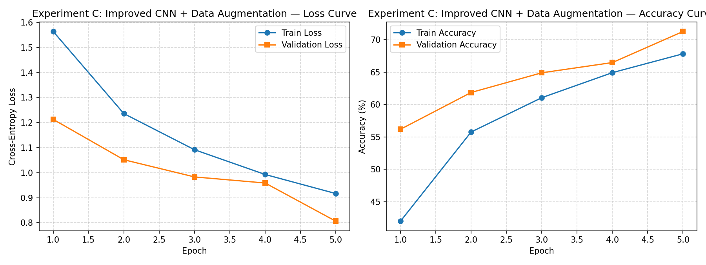

# CNN Image Classification Experiment Report

## 1. Objective

This report documents a controlled comparison of two CNN architectures
and the effect of data augmentation on CIFAR-10 image classification.
The project is an empirical engineering study, not a claim of a novel
algorithm.

## 2. Dataset and protocol

-   **Dataset:** CIFAR-10, 60,000 color images of size 32 × 32 across 10
    classes.
-   **Split:** 45,000 training images, 5,000 validation images, and
    10,000 held-out test images.
-   **Seed:** 42.
-   **Device:** CPU.
-   **Epochs:** 5 per experiment.
-   **Optimizer and loss:** SGD (learning rate 0.01, momentum 0.9,
    weight decay 5e-4) and cross-entropy loss.
-   **Checkpoint selection:** The checkpoint with the best validation
    accuracy was evaluated on the test set.

## 3. Experiments

1.  **Experiment A --- Baseline CNN, no augmentation.**
2.  **Experiment B --- Baseline CNN with random padded crop and random
    horizontal flip.**
3.  **Experiment C --- Improved CNN with Batch Normalization and
    Dropout, using the same augmentation as B.**

## 4. Results

  ----------------------------------------------------------------------------------------------------------------------------------
  Experiment   Model            Trainable Augmentation           Best       Test  Test loss       Macro    Macro Macro F1   Training
                               parameters                  validation   accuracy              precision   recall                time
                                                             accuracy                                                     
  ------------ ------------- ------------ -------------- ------------ ---------- ---------- ----------- -------- -------- ----------
  A            BaselineCNN      1,070,794 No                   73.72%     72.91%   0.796981      0.7258   0.7291   0.7263    318.4 s

  B            BaselineCNN      1,070,794 Yes                  69.00%     70.38%   0.852313      0.7071   0.7038   0.6982    349.3 s

  C            ImprovedCNN        620,586 Yes                  71.28%     71.89%   0.796874      0.7237   0.7189   0.7094    424.0 s
  ----------------------------------------------------------------------------------------------------------------------------------

Source: completed run output and `outputs/experiments_comparison.csv`.
Runtime values are rounded to one decimal place.

## 5. Interpretation

### 5.1 Baseline performance

Experiment A achieved the highest test accuracy (72.91%) and macro F1
(0.7263) in this run. This shows that the baseline CNN learned useful
image features over five epochs.

### 5.2 Data augmentation

Experiment B achieved 70.38% test accuracy, 2.53 percentage points below
Experiment A. In this particular five-epoch run, the augmented model did
not outperform the non-augmented baseline. This should not be
generalized to all augmentation settings or longer training schedules.

### 5.3 Architecture and parameter efficiency

Experiment C had 620,586 trainable parameters, compared with 1,070,794
for the baseline, a reduction of approximately 42.0%. Its test accuracy
was 71.89%, 1.02 percentage points below Experiment A. Thus, this model
was more parameter-efficient, but did not achieve the highest accuracy
in this run.

### 5.4 Runtime

Recorded training time was approximately 318.4 seconds for A, 349.3
seconds for B, and 424.0 seconds for C. The improved architecture took
the longest in this CPU run. Runtime can vary with hardware, background
workload, and software environment.

## 6. Visual analysis

### Experiment C training curves



### Experiment C confusion matrix


### Experiment C prediction examples


The training curves show the change in training and validation metrics
over five epochs. The confusion matrix provides a class-by-class view of
correct and incorrect predictions. Prediction examples support
qualitative inspection of selected correct and misclassified images.
Specific class-level claims should be made only after inspecting the
corresponding figures and per-class metrics.

## 7. Limitations and next steps

-   Each configuration was run for five epochs only.
-   Only one random seed (42) was used, so run-to-run variability is not
    measured.
-   The observed differences should not be interpreted as statistically
    significant.
-   A stronger follow-up study could train longer, repeat experiments
    with multiple seeds, and compare per-class errors before drawing
    broader conclusions.

## 8. Reproduction

From the project root, run:

``` powershell
.\.venv\Scripts\python.exe scripts\run_experiments.py --epochs 5
```

The consolidated table is saved to `outputs/experiments_comparison.csv`.
Model checkpoints, per-epoch histories, per-class metrics, logs,
metadata, and visualization files are saved under `outputs/` and
`reports/figures/`.
